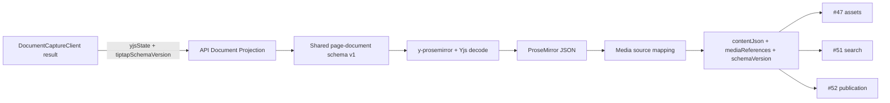

## Context

См. `proposal.md` и `specs/document-projection/spec.md`. Сейчас `apps/web/src/entities/page-document` владеет schema v1, `PAGE_CONTENT_YJS_FIELD = 'default'`, Yjs decoding и преобразованием `yXmlFragmentToProseMirrorRootNode` из `y-prosemirror`. `apps/api` содержит `DocumentCaptureClient`, который возвращает согласованные `yjsState`, `storageRevision` и `tiptapSchemaVersion`, но не интерпретирует содержимое. В OpenSpec уже закреплены opaque Yjs persistence, schema v1 и запрет молчаливо терять неизвестные nodes.

В текущей schema зарегистрированы nodes `doc`, `text`, `paragraph`, `heading`, `bulletList`, `orderedList`, `listItem`, `taskList`, `taskItem`, `hardBreak`, `image`, `video`, `youtube`; marks: `bold`, `code`, `italic`, `link`, `strike`. Image v1 хранит `nodeId`, HTTPS `src`, `alt`, `decorative`, `caption`, `alignment`, `widthPercent`. Web media URL validation принимает HTTPS; ID image nodes — UUID.

## Goals / Non-Goals

**Goals:**

- Иметь один browser-independent владелец редакторской schema и Yjs → ProseMirror conversion для web и backend.
- Получать JSON и media references из одного captured state, используя переданную версию schema.
- Сделать projection stateless и тестируемой без БД, Hocuspocus, сети или editor instance.
- Сохранить external image URLs и предусмотреть добавление internal asset references без переписывания boundary.

**Non-Goals:**

- Capture, повторное чтение `PAGE_DOCUMENTS`, snapshot creation, publication orchestration или сохранение `DOCUMENT_RENDERINGS`/asset tables.
- `PAGE_ASSETS`, `SNAPSHOT_ASSETS`, `ASSETS`, object storage, Prisma migrations, upload, signed URL resolution или authorization.
- Search/plain-text indexing, API endpoints/OpenAPI, editor UI, новые frontend media extensions или collaboration protocol changes.
- Schema migration framework или внедрение будущей image schema в editor в рамках этого change.

## Decisions

### 1. Общий package владеет browser-independent document schema

Добавить `apps/page-document` в существующую workspace область `apps/*`. Это доменный package, общий для двух конкретных потребителей — web editor и API projection, а не пакет исключительно для одного projection use case. В него перенести стабильные schema/version/Yjs conversion части текущей web entity. Web-only composition останется в web: Collaboration extension/caret, provider, React, editor surface и UI. API зависит только от общего package и не импортирует web app.

Рекомендуемая структура:

```text
apps/page-document/src/
  model/editor-schema.ts       # schema extensions v1 без editor/provider UI
  model/schema-version.ts      # version 1 и Yjs field `default`
  lib/yjs-state.ts             # decode, empty-state handling, JSON conversion
  lib/media-source.ts          # source contract и versioned image mapping
apps/api/src/document-projection/
  document-projection.ts       # чистая projection-функция
  document-projection.types.ts # вход, JSON, media references
  document-projection.errors.ts# typed decode/schema/media errors
  document-projection.spec.ts  # unit tests с реальными Yjs fixtures
apps/web/src/entities/page-document/
  ...                           # UI adapter/barrel делегируют общий schema package
```

Package export surface остаётся небольшим: schema factory/version, Yjs decode/conversion и media source types/mapping. Он не импортирует NestJS, React, Hocuspocus, database package или frontend aliases. Зависимости `@tiptap/core`, необходимые schema extensions, `@tiptap/pm`, `y-prosemirror` и `yjs` объявляются прямыми зависимостями общего package. Повторно используемые прямые версии TipTap/Yjs должны идти через pnpm catalog по repository policy; `@tiptap/react` и collaboration/caret extensions остаются в web.

Альтернатива — скопировать schema definitions в API — отклонена: она допускает drift persisted node attrs и defaults. Orval не подходит как schema source: он генерирует только REST types/client из `apps/api/openapi.json`, где нет TipTap nodes или Yjs contract.

### 2. Projection получает только captured bytes и schema version

Public application boundary концептуально:

```ts
interface DocumentProjection {
  contentJson: JSONContent;
  mediaReferences: MediaReference[];
  schemaVersion: number;
}

function projectDocument(input: {
  yjsState: Uint8Array;
  tiptapSchemaVersion: number;
}): DocumentProjection;
```

`storageRevision` остаётся у orchestration потребителя как provenance и не нужен для детерминированного преобразования. Caller передаёт поля уже полученного `CapturedDocumentState`; projection сама не инжектирует и не вызывает `DocumentCaptureClient`. Boundary — чистая функция с typed errors вместо Nest provider: она не открывает транзакции, не вызывает repositories и не имеет mutable state.



Projection создаёт собственный Y.Doc из bytes, декодирует согласованный fragment `default` и сериализует ProseMirror root в JSON через существующую библиотечную конвертацию. Входные bytes и caller-owned документ не меняются; editor instance, transaction и HTML rendering не создаются. Пустые bytes представляют valid empty Y.Doc и обрабатываются отдельно от `Y.applyUpdate`, согласованно с collaboration persistence contract. Ошибки декодирования нормализуются в явную projection error, не возвращая частичный output.

### 3. Поддержка schema version минимальна и fail-closed

На старте поддерживается только `PAGE_DOCUMENT_SCHEMA_VERSION = 1`, уже хранимая в `PAGE_DOCUMENTS.tiptapSchemaVersion`. Version admission выполняется до decode/mapping; неизвестное или некорректное значение завершается typed unsupported-schema error. Schema v1 формируется теми же TipTap extensions, что используют editor и conversion. Тест закрепляет точный набор nodes/marks и сопоставление ProseMirror JSON с Yjs fixture.

Не вводить общий миграционный framework. При добавлении schema v2 общий package получит отдельное versioned описание и явное правило read/compatibility в следующем согласованном change; registry из плагинов/классов не создаётся. Известный node type должен быть валиден в schema конкретной версии. Неизвестный node или невозможность сохранить содержимое приводит к явной ошибке; unsupported content не фильтруется.

### 4. Image source contract сохраняет legacy v1 и поддерживает asset future

Для v1 JSON остаётся фактическим ProseMirror JSON: legacy attrs `src` и `nodeId` не переписываются в `contentJson`. Media mapper строит из них derived reference:

```ts
type MediaReference =
  | { type: 'external'; nodeId: string; url: string }
  | { type: 'asset'; nodeId: string; assetId: string };

type ImageSource =
  | { type: 'external'; url: string }
  | { type: 'asset'; assetId: string };
```

Для будущей schema единый TipTap JSON image contract хранит `source: ImageSource`; `nodeId` остаётся идентификатором вхождения. Для переходной совместимости version-specific mapping v1 читает `src` как external; следующая editor schema сможет читать новую `source` форму и старые документы через явно определённый version adapter. Не мигрировать и не изменять Y.Doc при projection. В рамках этого change не добавлять v2 schema и не менять editor UI.

У текущего media node `nodeId` должен быть валидным UUID; missing/invalid ID — явная ошибка, не случайная генерация. External source v1 принимает только абсолютный HTTPS URL без credentials согласно действующей editor validation. `http:`, `javascript:`, `data:`, `file:` и `blob:` отклоняются; projection не выполняет `fetch`. Для asset mapping требуется стабильный asset ID без URL; точный persistence/authorization contract остаётся у #47. Два node с одинаковым источником сохраняют две references, если у них разные nodeId.

`image` — единственный тип узла, включаемый в image `mediaReferences` этого этапа: #47/#49 определяют node/asset relation для изображений. Текущие `video` и `youtube` остаются частью `contentJson`, но не становятся `PAGE_ASSETS` references и не получают image source mapping.

### 5. Интеграция отделена от consumers и persistence

- #47 может передать проекцию после собственного persisted-state trigger и использовать только `asset` references для `PAGE_ASSETS`; external URL не создаёт запись в `ASSETS` и не требует storage.
- #51 может позднее получить JSON для plain-text extraction из общего projection boundary; индексирование и persistence search не входят сюда.
- #52 может передать один capture в projection, а его JSON и references связать с тем же snapshot; transaction/publish/rendering persistence не входят сюда.
- `DocumentCaptureClient` и snapshots из PR #93 остаются источниками captured bytes/provenance и не переписываются.

Собственный storage добавит обработку `assetId` на consumer/resolution boundary. Существующие external URLs продолжат проецироваться как external; загрузка URL в assets, замена source и migration всех внешних изображений не требуются.

## Risks / Trade-offs

- **[Риск]** Общий package требует перемещения текущих schema/conversion exports и обновления двух consumers. → Переносить только browser-independent код и сохранить публичный web barrel/поведение editor; dependency direction остаётся web/API → page-document.
- **[Риск]** #49 сейчас описывает image node с `node_id` и `asset_id`, но не discriminator и external source. → Согласовать `source` union и backward-compatible v1 mapping в design/tasks #49 до его реализации; этот change не меняет UI.
- **[Ограничение]** External файл может исчезнуть или измениться после projection; URL не фиксирует байты ресурса. → Хранить URL как external reference и явно считать внешнее содержимое mutable; не заявлять его immutable snapshot content.
- **[Риск]** Старые или вручную изменённые Yjs states могут содержать image без nodeId, unsafe URL или незнакомый node. → Fail closed с конкретной ошибкой; не генерировать ID, не удалять node и не публиковать partial JSON.
- **[Trade-off]** HTTP внешние изображения отклоняются. → Schema v1 и текущая persisted-image validation поддерживают только HTTPS; расширение protocol policy требует изменения schema/security contract.

## Migration Plan

Изменений БД, Yjs persisted bytes и capture transport нет. Реализация извлекает общий schema/conversion code, затем web и API используют общий package. До merge review проверяет неизменность schema v1 и web behavior; откат возвращает исходные модули web без data migration. `openspec validate add-document-projection --strict` и API/web/package checks выполняются после реализации.

## Open Questions

Нет. Контракт для будущего image `source` должен быть согласован с #49 до реализации этой зависимости; текущая schema v1, поведение projection и границы change определены выше.
