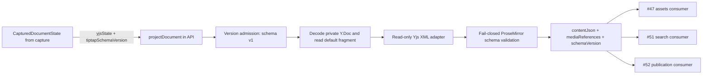

## Context

См. `proposal.md` и `specs/document-projection/spec.md`. `apps/web/src/entities/page-document` владеет persisted editor schema v1, Yjs field `default` и преобразованием через y-prosemirror. API получает согласованные `yjsState`, `storageRevision` и `tiptapSchemaVersion` через `DocumentCaptureClient`; projection принимает только первые и третье значения. `tiptapSchemaVersion` сейчас равен 1.

Persisted schema v1 включает nodes `doc`, `text`, `paragraph`, `heading`, `bulletList`, `orderedList`, `listItem`, `taskList`, `taskItem`, `hardBreak`, `image`, `video`, `youtube` и marks `bold`, `code`, `italic`, `link`, `strike`. Их content expressions, группы и defaults проверены по `getPageDocumentSchema()` текущего редактора:

| Node | Persisted shape / attrs и defaults |
| --- | --- |
| `doc` | `block+`; attrs нет |
| `paragraph` | `inline*`, group `block`; attrs нет |
| `heading` | `inline*`, group `block`; `level: 1`, editor levels `[1, 2, 3]` |
| `bulletList` | `listItem+`, group `block list`; attrs нет |
| `orderedList` | `listItem+`, group `block list`; `start: 1`, `type: null` |
| `listItem` | `paragraph block*`; attrs нет |
| `taskList` | `taskItem+`, group `block list`; attrs нет |
| `taskItem` | `paragraph block*`; `checked: false` |
| `hardBreak` | inline node, group `inline`; attrs нет |
| `image` | atom, group `block`; `alignment: 'center'`, `caption: null`, `nodeId: null`, `widthPercent: 100`, `alt: ''`, `decorative: false`, `src: null` |
| `video` | atom, group `block`; `alignment: 'center'`, `caption: null`, `nodeId: null`, `widthPercent: 100`, `src: null` |
| `youtube` | atom, group `block`; `alignment: 'center'`, `caption: null`, `nodeId: null`, `widthPercent: 100`, `videoId: null` |
| `text` | group `inline`; attrs нет |

Marks `bold`, `italic` и `strike` не имеют attrs; `code` не имеет attrs и исключает остальные marks; `link` сохраняет только `href: null`. Backend дублирует эти persisted declarations и стандартные ProseMirror mark/node semantics, но не TipTap DOM parsing/rendering, команды, collaboration, расширения editor или UI. Для всех трёх существующих media nodes projection повторяет persisted validation и normalization из frontend: UUID `nodeId`; общие `alignment`, `caption`, `widthPercent`; image `src`, `alt`, `decorative`; video `src`; youtube `videoId`. `mediaReferences` при этом содержит только image occurrences.

В текущей persisted schema числовые attrs — `heading.level`, `orderedList.start` и media `widthPercent`. Для `heading.level` editor задаёт уровни `[1, 2, 3]`; media `widthPercent` использует frontend normalization через `Number()`, fallback 100 для non-finite значения, округление и clamp 25–100. `orderedList.start` имеет schema default `1` и принимает только safe integers, включая отрицательные значения и обе границы диапазона. Других числовых persisted attrs в schema v1 нет. `taskItem.checked` проверяется как boolean, `orderedList.type` как string либо `null`, `link.href` — как строка, проходящая frontend normalizer.

## Goals / Non-Goals

**Goals:**

- Дать API минимальную backend-local schema v1 и один детерминированный projection boundary для повторного использования #47, #51 и #52.
- Fail closed на любом неизвестном или теряемом содержимом до возврата JSON.
- Держать frontend runtime неизменным и контролировать дублированные persisted schema declarations реальными versioned fixtures.
- Сохранить external media как постоянный тип источника и оставить boundary пригодной для будущих asset references.

**Non-Goals:**

- Общий workspace package, перенос schema/Yjs кода из `apps/web`, frontend import/re-export changes, рефакторинг Collaboration, NodeIdDeconflict или editor composition.
- Реализация schema v2, текущая поддержка внутренних asset nodes, asset resolution/authorization, публикации, storage/persistence, search indexing, БД migrations, endpoints, SSR или UI.
- Автоматическая синхронизация schema, миграционный framework, plugin registry, factories или иерархия projection services.

## Decisions

### 1. Projection и schema остаются локальными в API

Рекомендуемая структура:

```text
apps/api/src/document-projection/
  document-projection.ts          # pure projectDocument() и orchestration локальных шагов
  document-projection.schema.ts   # минимальная ProseMirror schema v1
  document-projection.errors.ts   # typed decode/schema/media errors
  document-projection.spec.ts     # unit и негативные conversion tests
  document-projection.compatibility.spec.ts # проверка общей v1 fixture
fixtures/page-document/schema-v1/
  rich-document.json              # Yjs update base64 и ожидаемый ProseMirror JSON
```

`projectDocument({ yjsState, tiptapSchemaVersion })` принимает captured bytes, не `CapturedDocumentState` целиком, и возвращает `{ contentJson, mediaReferences, schemaVersion }`. Это pure function без Nest provider/module, DI, mutable state или editor instance. Внутри создаётся собственный временный `Y.Doc`; empty bytes обрабатываются как пустой документ без вызова `Y.applyUpdate`. Текущий frontend conversion представляет полностью пустой Yjs fragment как `{ "type": "doc" }`. Это совместимое persisted/frontend представление, хотя оно не проходит validation текущего ProseMirror top node с content expression `block+`; API сохраняет его отдельной empty-document веткой. Будущие publication и SSR consumers обязаны распознавать это значение как пустой документ и не трактовать его как повреждённый projection. Projection не получает capture client, storage revision или доступ к странице.

Data flow:



API объявляет прямые runtime dependencies только на `yjs` и `@tiptap/pm`: первый уже находится в pnpm catalog, второй используется также web и получает общую catalog version. `y-prosemirror` остаётся dependency frontend, но API не импортирует его conversion helpers. Это не создаёт package/workspace participant и не меняет frontend runtime.

Рассматривался общий schema package, но он расширил бы scope изменениями frontend imports и ownership. Ручная backend-local схема меньше по радиусу изменений и допускает намеренное дублирование, если оно проверяется fixtures.

### 2. Schema v1 дублирует только persisted ProseMirror contract

Backend `Schema` описывает точный список nodes/marks текущего editor schema и все данные, влияющие на persisted JSON: content expressions, группы, inline/block/atom свойства, attrs, defaults и mark attrs. Она не импортирует исходники `apps/web` и не создаёт TipTap extensions. Web compatibility test получает реальную frontend `Schema` через `getPageDocumentSchema()` и сравнивает её nodes, marks, attr names/defaults и schema version с backend `Schema`; поэтому новое schema extension или изменение persisted attr/default выявляется без дополнительного manifest. UI-only extensions без ProseMirror nodes/marks не входят в сравнение. `tiptapSchemaVersion = 1` и fragment name `default` фиксируются backend-local.

Корневые versioned fixtures хранят base64 Yjs updates, созданные реальным frontend editor schema v1, и ожидаемый JSON. Основной compatibility fixture включает текст с несколькими одновременными marks, `link` с attrs, соседние текстовые сегменты, вложенные list/task nodes и валидные `image`, `video`, `youtube` nodes одновременно. Web compatibility test сверяет fixture с текущим `pageDocumentToJSON`; API test применяет те же bytes к локальной schema и сверяет полный JSON, типы и вложенность nodes, наборы marks, mark attrs, media attrs и defaults. Отдельные fixtures покрывают пустой и error-state cases. Backend и web читают одни и те же versioned fixture files без общего package.

При изменении persisted schema разработчик вручную обновляет frontend schema version, backend-local schema/validation, versioned fixture и оба compatibility tests в одном согласованном изменении. Автоматический extractor, codegen или schema synchronization framework не добавляется.

После `document.check()` projection использует встроенный `document.toJSON()` для публичного `contentJson`. Собственный serializer ProseMirror nodes не нужен. Семантическое сравнение нормализует только raw adapter JSON: добавляет schema defaults, убирает пустой `content`, приводит marks к schema order и объединяет соседние текстовые segments с одинаковыми marks — то, что ProseMirror уже делает при построении и сериализации документа. Проверки неизвестных Yjs nodes/marks/attrs и структуры остаются до сериализации.

### 3. Read-only adapter строит JSON, затем schema валидирует его

Backend-local adapter обходит уже декодированные публичные Yjs типы и строит JSON без чтения CRDT internals или обработки update bytes:

1. `Y.XmlFragment` и `Y.XmlElement` обходятся через `toArray()`; элементы сериализуются как `{ type: nodeName, attrs?, content? }`, сохраняя порядок и все attrs.
2. `Y.XmlText` читается через `toDelta()`. Каждый string insert становится text node; каждый delta format становится ProseMirror mark с исходными attrs. Неподдерживаемые inserts, XML child types или не-JSON attrs завершаются typed error.
3. Для совместимости с y-prosemirror v1.3.7 adapter понимает mark keys по правилу `/(.*)(--[a-zA-Z0-9+/=]{8})$/`: только соответствующий suffix удаляется для определения типа mark, а attrs mark передаются без изменения. Обычные и hash-suffixed keys должны давать тот же mark type и сохранять его attrs при нормализации; несколько одновременно применённых marks не теряются. Неизвестные marks и конфликтующие marks, которые после декодирования схлопываются в один тип с разными attrs, завершаются явной ошибкой. Это локальная реализация persisted naming convention, без импорта y-prosemirror API или private internals. Основные compatibility fixtures создаёт frontend; отдельная настоящая Yjs delta fixture, построенная публичным Yjs API, покрывает hash-suffix формат, который текущий editor может не генерировать.
4. Неизвестные node/mark types и attrs проверяются до normalization, поскольку ProseMirror conversion может игнорировать лишние attrs. Для media nodes backend применяет persisted frontend validators к attrs; если validator принимает значение и нормализует его, adapter записывает канонические attrs в projection JSON. Если validator отклоняет attrs, projection завершается typed media error.
5. Канонические attrs `contentJson` используются и для `mediaReferences`: image reference получает тот же `nodeId` и нормализованный URL, что и итоговый `image.attrs`. Семантическое сравнение raw и итогового дерева сначала применяет к raw media attrs те же validators и нормализует raw `link.href` тем же `normalizePageDocumentLink()`, затем выявляет любую иную утрату/изменение nodes, порядка, текста, attrs, marks или mark attrs. Разрешённые canonical transformations включают нормализацию media attrs и `link.href`; ссылка в projection сравнивается в canonical form, записанной в `contentJson`. Также не считаются потерей отсутствующий/пустой `content`, adjacent text segments с одинаковыми marks и порядок marks при совпадающем наборе и attrs. Любое отличие сверх этих явно разрешённых преобразований возвращает typed schema error. Нормализация действует только на projection result и не изменяет captured bytes или Y.Doc.

Полностью пустой fragment обрабатывается до `block+` validation и даёт frontend-compatible `{ "type": "doc" }`; это значение не является ProseMirror schema-valid doc, но представляет текущее пустое persisted состояние. Будущие publication и SSR consumers обязаны трактовать его как пустой документ. Для остальных документов конвертация не возвращает partial result и не мутирует Y.Doc или captured bytes.

### 4. Persisted attrs с дополнительными ограничениями проверяются точечно

ProseMirror schema задаёт attrs и defaults, но сама по себе не гарантирует persisted runtime-типы. Projection валидирует только конкретные ограничения schema v1: `heading.level` — одно из `1`, `2`, `3`; `taskItem.checked` — boolean; отсутствующий `orderedList.start` получает schema default `1`; `orderedList.type` — string или `null`; `link.href` — string, принимаемая frontend normalizer. Для media attrs используются перечисленные ниже frontend-equivalent validators. Для этих правил не вводится общий validation framework. Любое недопустимое значение завершает projection typed error до выдачи результата.

`orderedList.start` получает schema default `1`, если attr отсутствует. Явно сохранённое значение должно быть safe integer; ноль, отрицательные значения и `Number.MIN_SAFE_INTEGER`/`Number.MAX_SAFE_INTEGER` разрешены. Дробные, non-finite и выходящие за safe integer диапазон значения отклоняются typed schema error. Projection не подменяет заданное некорректное значение default-ом.

Текущий `normalizePageDocumentLink()` разрешает только canonicalization: обрезает внешние whitespace; добавляет `https://`, если scheme отсутствует; разбирает значение как WHATWG `URL`; разрешает `http:`, `https:` и `mailto:`; для HTTP(S) требует hostname и запрещает username/password, для mailto требует непустой pathname. Итоговое `URL.href` записывается в `contentJson`. Иные преобразования ссылки не допускаются. Отсутствующий, нестроковый или недопустимый href вызывает typed schema error и projection не возвращает частичный результат. Normalization затрагивает только result: captured Yjs bytes и исходный Y.Doc не изменяются.

**Альтернатива — strict preflight плюс `yXmlFragmentToProseMirrorRootNode`.** Предварительная проверка всё равно должна пройти все элементы и marks, понять encoded mark names, проверить attrs и структуру против schema. Затем binding повторно обходит дерево и применяет собственное преобразование; его error paths фильтруют и могут удалять элементы из переданного Y.Doc. Для доказательства сохранности потребовались бы отдельная копия/проверка мутаций и semantic comparison результата с preflight. Такой двойной pipeline сложнее однопроходного adapter и сильнее зависит от поведения binding. Самостоятельное декодирование CRDT или приватных полей Yjs не рассматривается.

### 5. Persisted media validation соответствует frontend, references остаются image-only

Projection проверяет сохранённые attrs `image`, `video`, `youtube` теми же правилами, что `normalizePersistedPageDocumentImageAttributes`, `normalizePersistedPageDocumentVideoAttributes` и `normalizePersistedPageDocumentYoutubeAttributes` в текущем frontend. Backend держит локальные копии правил, не импортируя `apps/web`:

- Для каждого media node `nodeId` должен соответствовать UUID pattern `^[0-9a-f]{8}-[0-9a-f]{4}-[1-8][0-9a-f]{3}-[89ab][0-9a-f]{3}-[0-9a-f]{12}$` без учёта регистра.
- Общие attrs нормализуются одинаково и попадают в `contentJson`: alignment из `start|center|end`, иначе `center`; caption обрезается, пустое/нестроковое значение становится `null`; width преобразуется через `Number()`, non-finite значение становится 100, иначе округляется и ограничивается диапазоном 25–100 (поэтому, например, `140` становится `100`).
- Image: `src` обрезается; если схема отсутствует, добавляется `https://`; принимается только HTTPS с hostname и без username/password. `alt` обрезается; `decorative` — true только при точном `true`; decorative image требует пустой alt, обычное — непустой.
- Video: те же правила HTTPS URL, плюс pathname должен оканчиваться на `.mp4` или `.webm` без учёта регистра.
- YouTube: persisted `videoId` должен соответствовать `^[A-Za-z0-9_-]{11}$`. Projection проверяет только это сохранённое значение; разбор исходных YouTube URLs и получение `videoId` остаются ответственностью frontend.

Валидация возвращает те же нормализованные attrs, что frontend validators; они заменяют raw media attrs только в projection `contentJson`. Недопустимые media attrs приводят к typed media error без частичного результата. Только валидный `image` создаёт derived `MediaReference`; его `url` должен совпадать с каноническим `src` соответствующего image node в `contentJson`. Video и YouTube остаются в `contentJson`, их attrs проверяются, но references для этих типов пока не создаются. Уникальность `nodeId` проверяется среди всех трёх media node types, одинаковые URL при разных IDs допустимы.

### 6. Image v1 и future asset source имеют стабильную границу

Контракт domain media source:

```ts
type ImageSource =
  | { type: 'external'; url: string }
  | { type: 'asset'; assetId: string };

type MediaReference =
  | { type: 'external'; nodeId: string; url: string }
  | { type: 'asset'; nodeId: string; assetId: string };
```

Schema v1 ProseMirror JSON остаётся совместимым с текущим editor: `image.attrs.src` вместе с `nodeId`. Projection проверяет attrs перечисленными persisted image rules, отражает допустимые canonical values в output JSON и строит external reference из того же нормализованного URL; Y.Doc не переписывается. Имя `ImageSource` задаёт source union для будущей версии, но текущая schema не принимает `assetId` и asset reference не считается реализованным до появления versioned persisted schema.

В schema v2 будущий editor сможет хранить `source` discriminated union. Version-specific projection mapping преобразует legacy v1 `src` в external и v2 `source` в соответствующий reference. Добавление такого mapper и schema v2 не должно менять сигнатуру projection или обработку v1. Asset URL, signed URL, доступ и resolution принадлежат отдельному asset layer. `video`/`youtube` остаются в JSON и не входят в image media references этого этапа.

External image URL проверяется локально по текущим persisted image rules: URL без схемы canonicalized добавлением `https://`, затем принимается только HTTPS без credentials с hostname. Явный HTTP, опасная схема (`javascript:`, `data:`, `file:`, `blob:`), credentials, пустой hostname или некорректный URL приводят к media error. Канонический URL записывается в image JSON и reference. Video URL нормализуется теми же правилами и дополнительно ограничен `.mp4`/`.webm`; canonical value записывается в JSON. YouTube URL parsing здесь отсутствует: persisted `videoId` проверяется напрямую. Projection не делает fetch, download или availability check. Отсутствующий `nodeId` не генерируется. Повтор `nodeId` между любыми image/video/youtube nodes завершает projection ошибкой. Одинаковые URL у разных nodes допустимы; каждое image occurrence остаётся отдельной reference.

Переход #49 должен согласовать будущую форму `source` с `ImageSource`; это не требует добавлять frontend extensions в текущий change. #47 может использовать только asset references после появления persisted asset node/schema. #51 получает тот же `contentJson` для последующего извлечения plain text. #52 может связать projection и media refs с исходным capture/snapshot. Ни один consumer не включается в реализацию projection.

### 6. Ошибки и безопасность остаются локальными

Typed errors различают unsupported schema version, invalid Yjs state, unsupported/lossy ProseMirror schema content и invalid media attributes. Никакая ошибка не возвращает частичный projection. JSON остаётся данными, не HTML; projection не обращается к сети и не выдаёт URL с подписью.

## Risks / Trade-offs

- **Schema duplication can drift** → Общая frontend-generated v1 fixture проверяется web и API tests; изменение persisted schema требует согласованного обновления обеих деклараций, версии и fixture. Автоматической синхронизации нет.
- **Правило hash suffix для marks может измениться вместе с y-prosemirror** → Schema-v1 compatibility fixtures и focused tests закрепляют текущий формат имени, а при несовместимом изменении persisted format потребуется отдельное versioned решение.
- **Некорректный legacy документ может перестать проецироваться** → Явно вернуть typed error вместо публикации документа с потерянным содержимым. Отдельно human review должен подтвердить, что текущие persisted документы удовлетворяют существующим media и link validation rules.
- **External resource может измениться или исчезнуть** → Projection фиксирует URL, но не содержимое стороннего файла; snapshot внешнего файла не считается immutable.
- **Schema v2 и #49 могут выбрать другую форму media source** → Зафиксированный source union служит согласованным target contract; до внедрения #49 сравнить его с этим design и обновить change при несовпадении.
- **Пустой frontend document не проходит ProseMirror `block+` validation** → Projection сохраняет совместимое `{ "type": "doc" }` представление; каждый будущий publication/SSR consumer обрабатывает его как пустой документ.
- **HTTP URL будет rejected текущими persisted rules** → Сохранять действующую HTTPS policy; изменение protocol policy требует отдельного review и совместимого изменения frontend validation.

## Migration Plan

Persisted data, DB schema, capture transport, snapshots и frontend runtime не меняются. API использует Yjs и ProseMirror model напрямую; `y-prosemirror` conversion helper не входит в API dependencies. Перед merge выполняются fixture checks API/web и `openspec validate add-document-projection --strict`; implementation checks затем выполняются согласно tasks. Если adapter или media validation обнаружит ранее сохранённый несовместимый документ, результатом будет явная ошибка без исправления Y.Doc или миграции в рамках этого change.

## Open Questions

Нет. До реализации необходимо включить текущие defaults полного TipTap v1 в минимальную backend schema, подтвердив их fixture и editor schema tests; это проверяемая задача, а не выбор между архитектурами.
